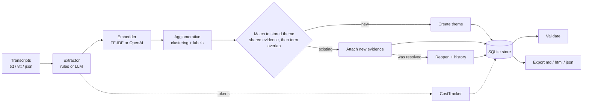

# feedback-theme-engine

[](https://github.com/mikkoatienza/feedback-theme-engine-demo/actions/workflows/ci.yml)
 

Turn customer call transcripts into a **living board of product themes**. Rebuild it every night, and the decisions your product team made (resolved, dismissed) carry over to the next run.

This is a starter framework, not a hosted product. It works offline with rule-based extraction and TF-IDF clustering. You can plug in an LLM or an embeddings provider when you want better recall.

> The sample data in `examples/transcripts` is entirely synthetic.

## Features
- **Ingestion** of plain text (`Speaker: words`), WebVTT captions (with `<v Speaker>` tags) and JSON. Account and date can come from headers.
- **Extraction** of feedback items, each tagged `pain`, `request`, `confusion` or `praise`.
  - Rule-based keyword signals set in YAML, with your own team's speakers excluded.
  - An optional LLM extractor that returns JSON and falls back to the rules when the output is unusable.
- **Clustering** behind an `Embedder` interface. Comes with a pure-Python TF-IDF embedder and an optional OpenAI embedder, plus agglomerative clustering with a threshold you can tune.
- **Persistent SQLite store** for themes, evidence, status history and run records.
- **Lifecycle** of `open → resolved / dismissed → open`:
  - Resolved themes **reopen automatically when new evidence arrives**.
  - Dismissed themes stay dismissed.
  - Re-running on the same data creates no duplicates.
- **Validation** after every rebuild: empty or duplicate themes, orphaned evidence, and a single theme holding too much of the evidence.
- **Cost tracking** per run: LLM calls, input and output tokens, and estimated USD from the prices you configure.
- **Exports** to a Markdown board, a standalone HTML board, or JSON.

## Quickstart
```bash
pip install "git+https://github.com/mikkoatienza/feedback-theme-engine-demo"
feedback-themes init                                   # writes themes.yaml
feedback-themes --db themes.db rebuild ./transcripts -c themes.yaml
feedback-themes --db themes.db list
feedback-themes --db themes.db resolve report-csv -m "Shipped streaming export"
feedback-themes --db themes.db export -f html -o board.html
feedback-themes --db themes.db runs                    # history, tokens, cost
```
To run it nightly, add a cron entry:
```cron
0 2 * * *  cd /srv/feedback && feedback-themes --db themes.db rebuild ./transcripts -c themes.yaml
```
`rebuild` exits with `2` when validation finds problems, so your scheduler can alert on it.

### Demo
```bash
pip install -e ".[dev]" && python examples/run_demo.py
```
The demo builds a board from week 1. Next, it resolves the CSV-export theme. Then it rebuilds with week 2, and the theme reopens because a new customer reports the same problem.

## Architecture


| Module | Responsibility |
|---|---|
| `ingest.py` | Parsers for text, VTT, JSON |
| `extract.py` | `Extractor` protocol: `RuleExtractor`, `LLMExtractor` |
| `embed.py` | `Embedder` protocol: `TfidfEmbedder`, `OpenAIEmbedder` |
| `cluster.py` | Clustering and labeling |
| `store.py` | SQLite schema, lifecycle, history, runs |
| `engine.py` | Rebuild pipeline and matching rules |
| `validate.py`, `cost.py`, `export.py` | Checks, token/cost tracking, board output |

## Configuration (`themes.yaml`)
```yaml
extractor: rules            # rules | llm
llm_provider: anthropic     # offline | openai | anthropic  (or LLM_PROVIDER)
embeddings: tfidf           # tfidf | openai               (or EMBEDDINGS_PROVIDER)
internal_speakers: [Host, Interviewer]
threshold: 0.3              # higher = more, tighter themes
match_threshold: 0.5        # term overlap to re-attach to an existing theme
prices: {input_per_million: 0, output_per_million: 0}   # fill in from your provider
signals:
  pain: [slow, broken, times out]
  request: [please add, would love]
```
API keys are read from `OPENAI_API_KEY` / `ANTHROPIC_API_KEY`. Install the extras you need: `.[openai]`, `.[anthropic]`. Prices default to 0, so cost estimates stay at $0 until you enter your provider's prices.

## Extension guide
- **New transcript source** (Zoom, Gong, a CRM export): convert it to `Transcript(id, account, date, utterances)`.
- **Better extraction:** implement `extract(transcript) -> list[FeedbackItem]`.
- **Better clustering:** implement `embed(texts) -> list[list[float]]` (sentence-transformers, Cohere, a local model).
- **Custom checks:** call your own functions after `Engine.rebuild()`, or extend `validate()`.
- **Composition in Python:**
```python
from feedback_themes.engine import Engine
from feedback_themes.store import Store

engine = Engine(Store("themes.db"), MyExtractor(), MyEmbedder())
summary = engine.rebuild(transcripts)
```

## Roadmap
- LLM theme naming and one-paragraph summaries per theme
- Trend view (mentions per week) and "new this week" highlights
- Merge/split commands for themes
- Web UI on top of the SQLite store
- Connectors for common call-recording exports

## Development
```bash
pip install -e ".[dev]"
ruff check . && ruff format --check . && mypy && pytest
```
See [CONTRIBUTING.md](CONTRIBUTING.md) and [CHANGELOG.md](CHANGELOG.md).

## License
MIT © Mikko Atienza
